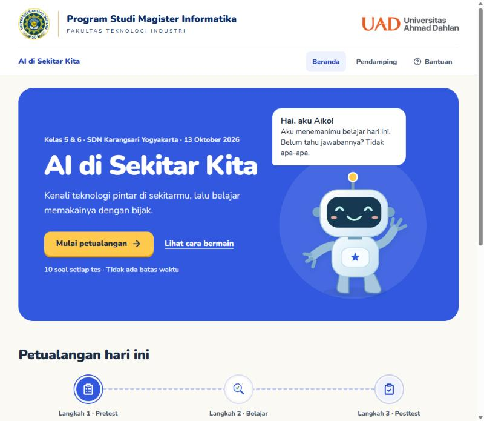
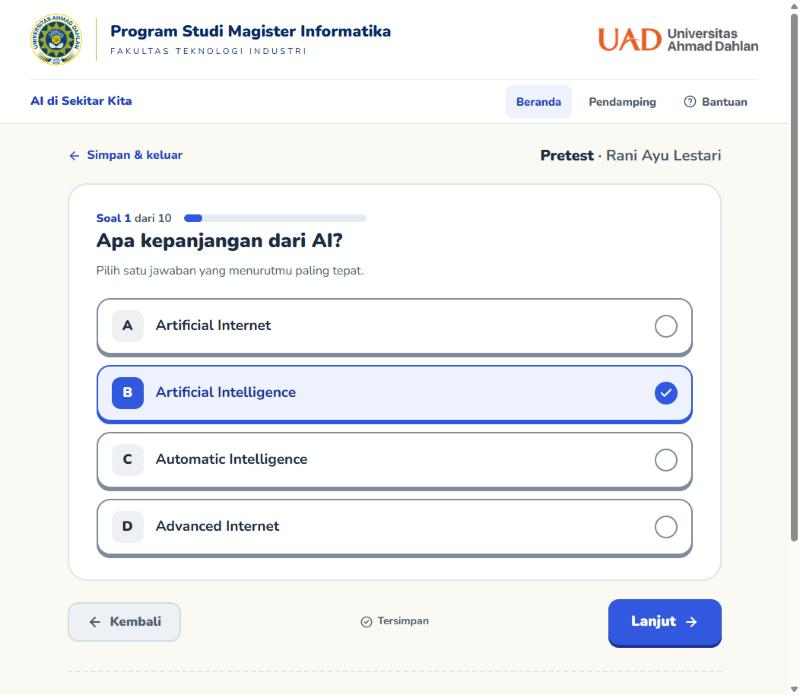
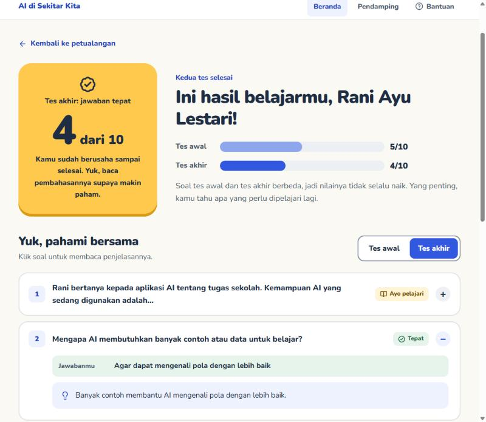
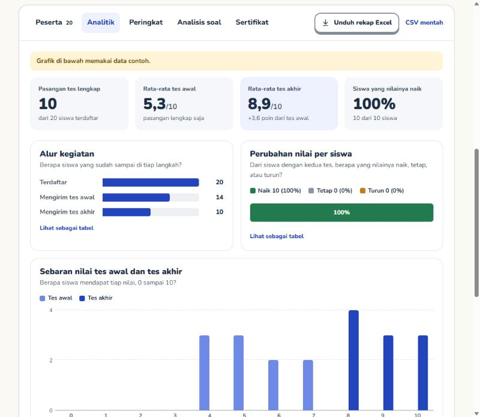
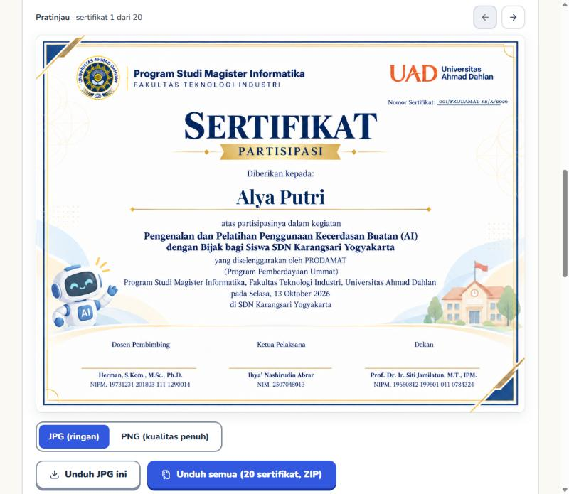
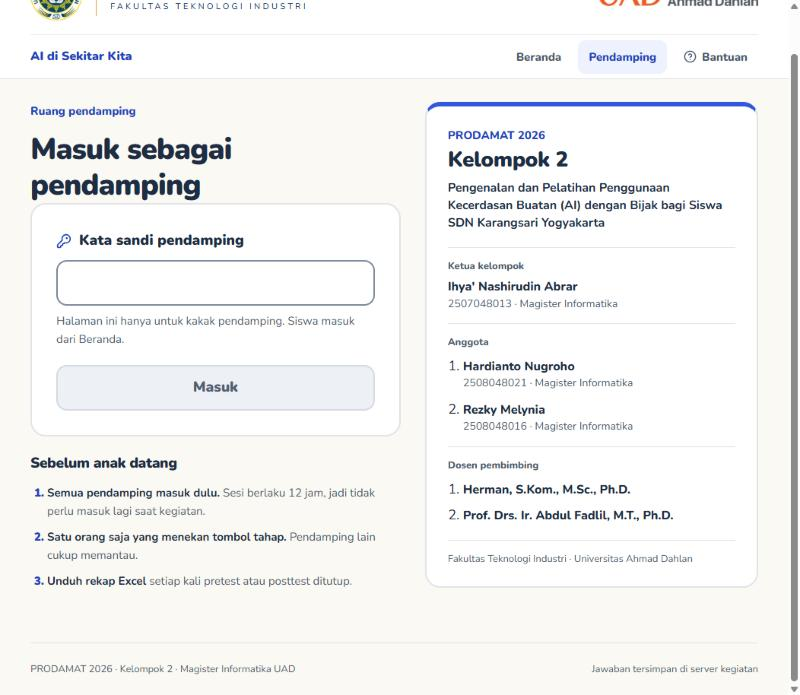
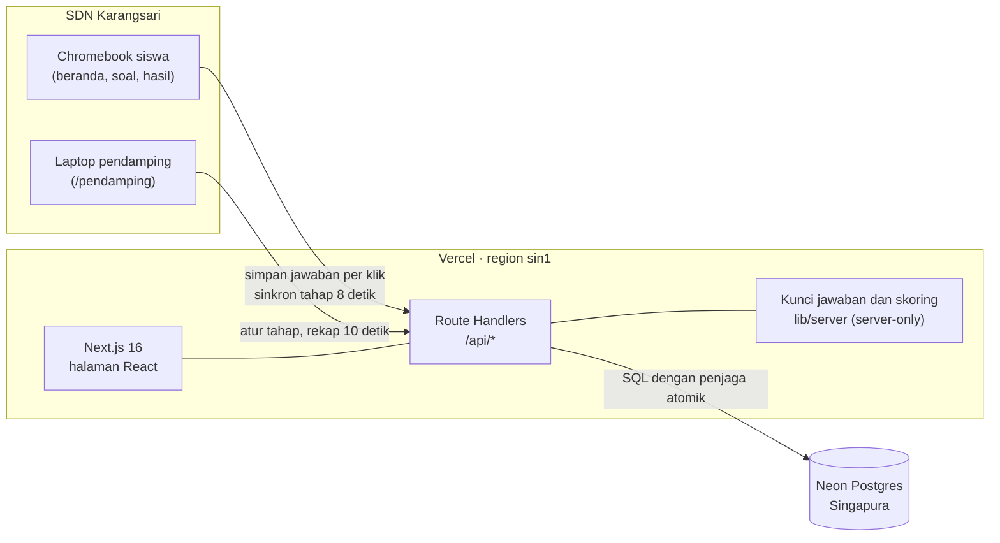
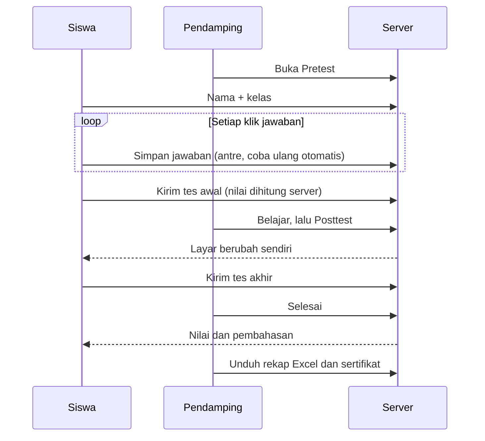

<div align="center">


&nbsp;&nbsp;&nbsp;

&nbsp;&nbsp;&nbsp;


# AI di Sekitar Kita

**Aplikasi pretest dan posttest yang ramah anak untuk pelatihan penggunaan AI dengan bijak**<br>
PRODAMAT 2026 · Kelompok 2 · Magister Informatika, Universitas Ahmad Dahlan

[](https://prodamat.vercel.app)


[Tentang](#tentang-kegiatan) · [Tampilan](#tampilan) · [Fitur](#fitur) · [Arsitektur](#arsitektur) · [Menjalankan](#menjalankan-di-komputer) · [Hari-H](#persiapan-hari-h) · [Tim](#tim-kelompok-2)

</div>

---

## Tentang kegiatan

| | |
|---|---|
| **Program** | Pengenalan dan Pelatihan Penggunaan Kecerdasan Buatan (AI) dengan Bijak bagi Siswa SDN Karangsari Yogyakarta |
| **Waktu** | Selasa, 13 Oktober 2026 |
| **Tempat** | SDN Karangsari, Rejowinangun, Kotagede, Kota Yogyakarta |
| **Peserta** | Siswa kelas 5 dan 6, memakai Chromebook sekolah |
| **Penyelenggara** | Program Studi Magister Informatika, Fakultas Teknologi Industri, Universitas Ahmad Dahlan |

Anak mengerjakan **tes awal (pretest)** sebelum materi, mengikuti materi dan permainan **Jadi Detektif AI**, lalu mengerjakan **tes akhir (posttest)**. Setiap tes berisi 10 soal pilihan ganda tanpa batas waktu. Kakak pendamping mengatur tahap kegiatan dari dashboard, memantau siswa, mengunduh rekap, dan membuat sertifikat.

## Tampilan

<table>
  <tr>
    <td width="50%"><br><sub><b>Beranda.</b> Satu tombol mulai, Aiko menyapa, jalur tiga langkah.</sub></td>
    <td width="50%"><br><sub><b>Soal.</b> Satu soal per layar, kartu jawaban besar, tersimpan otomatis.</sub></td>
  </tr>
  <tr>
    <td><br><sub><b>Hasil.</b> Nilai dengan bahasa yang menenangkan dan pembahasan tiap soal.</sub></td>
    <td><br><sub><b>Analitik.</b> Angka utama, alur kegiatan, perubahan nilai, sebaran nilai.</sub></td>
  </tr>
  <tr>
    <td><br><sub><b>Sertifikat.</b> Nama dan nomor otomatis, pratinjau, unduh semua dalam ZIP.</sub></td>
    <td><br><sub><b>Ruang pendamping.</b> Identitas Kelompok 2 dan daftar persiapan.</sub></td>
  </tr>
</table>

## Fitur

### Untuk siswa

- **Masuk tanpa kata sandi.** Cukup nama dan kelas; nama dan kelas yang sama di Chromebook mana pun melanjutkan pekerjaan yang sama.
- **Aiko sebagai pemandu.** Satu gelembung, satu instruksi per layar. Pose berganti sesuai situasi: melambai, membaca, berpikir, merayakan, menenangkan. Aiko tidak tampil di layar soal agar anak fokus.
- **Jalur petualangan.** Langkah yang sedang dibuka berwarna biru dengan tombol, langkah selesai hijau, langkah terkunci menyebut alasannya.
- **Jawaban aman saat Wi-Fi tersendat.** Setiap klik langsung disimpan, dicoba ulang otomatis, dan bila tetap gagal muncul tombol **Simpan lagi**. Tombol kirim menunggu sampai semua tersimpan.
- **Muat di Chromebook.** Pada layar pendek soal dirapatkan dan tombol Lanjut menempel di bawah, jadi anak tidak perlu menggulir.
- **Hasil yang ramah.** Pesan ditentukan dari nilai tes akhir; nilai yang turun tidak ditampilkan sebagai angka minus. Pembahasan baru dibuka saat pendamping menutup sesi agar kunci tidak tersebar ke teman yang masih mengerjakan.

### Untuk pendamping

| Fitur | Keterangan |
|---|---|
| Atur tahap | Pretest, Belajar, Posttest, Selesai. Setiap perubahan dikonfirmasi dan menyebut siswa yang masih mengerjakan. Layar siswa ikut berubah dalam sekitar 8 detik. |
| Peserta | Progres tiap siswa (misalnya *Mengerjakan 6/10*), pencarian, filter kelas, ubah nama atau kelas, hapus siswa. |
| Analitik | Rata-rata tes awal dan akhir, persentase siswa yang naik, alur kegiatan, sebaran nilai 0 sampai 10, perbandingan kelas, dan soal yang paling perlu diulas. Setiap grafik punya tooltip dan tampilan tabel. |
| Peringkat | Berdasarkan nilai tes akhir; nilai sama berbagi peringkat. |
| Analisis soal | Persentase benar per soal untuk tiap tes. |
| Sertifikat | Nama otomatis dari peserta, nomor bertambah otomatis dari nomor pertama (huruf tetap), nama dan nomor bisa dikoreksi per siswa, pratinjau, unduh JPG atau PNG, dan **unduh semua dalam satu ZIP**. |
| Rekap Excel | Empat sheet berformat: Ringkasan, Peserta, Jawaban (hijau = tepat, ada baris kunci), Analisis soal (bilah data dan sebaran pilihan A sampai D). CSV mentah tetap tersedia. |
| Mulai sesi baru | Menghapus semua data kegiatan setelah mengetik `MULAI BARU` dan menjawab "Apakah kamu yakin?". |

## Arsitektur





| Lapisan | Teknologi |
|---|---|
| Antarmuka | Next.js 16 (App Router), React 19, TypeScript, CSS biasa, font Nunito lokal, ikon Lucide |
| Server | Route Handlers di `app/api`, node-postgres dengan `attachDatabasePool` |
| Data | Neon Postgres (paket Free, Singapura), skema di `db/schema.sql` |
| Ekspor | exceljs (dimuat saat diperlukan), fflate untuk ZIP, Canvas untuk sertifikat |
| Hosting | Vercel Hobby, deploy otomatis dari `main` |

## Keamanan dan privasi data anak

- Yang disimpan hanya **nama, kelas, dan jawaban**. Tidak ada email, nomor telepon, atau kata sandi siswa.
- Kunci jawaban, pembahasan, dan skoring hanya ada di server. Soal dikirim ke siswa tanpa kunci; bundel browser diperiksa bebas kunci.
- Sesi memakai token acak di cookie HttpOnly; database hanya menyimpan hash token.
- Dashboard memakai satu kata sandi pendamping (`PENDAMPING_PASSWORD`) dengan batas 30 percobaan salah per 15 menit per IP.
- Menyimpan dan mengirim jawaban dijaga satu pernyataan SQL: tahap harus cocok, tes belum terkirim, posttest butuh pretest, jawaban lengkap. Kiriman ganda tidak mengubah nilai.
- Rekap Excel memberi kode peserta (P001, P002, ...) untuk dipakai di laporan agar nama anak tidak dipublikasikan.
- Rata-rata dan selisih dihitung dari pasangan tes lengkap. Soal tes awal dan akhir berbeda, jadi selisih nilai bersifat deskriptif.

## Menjalankan di komputer

```sh
npm install
npx vercel env pull .env.local     # DATABASE_URL dan lainnya dari Vercel
npm run dev
```

Buat `.env.development.local` (tidak ikut git) agar uji lokal tidak menyentuh data kegiatan asli:

```sh
PRODAMAT_ACTIVITY_ID=uji-lokal
PENDAMPING_PASSWORD=<kata sandi uji lokal>
```

| Variabel | Fungsi |
|---|---|
| `DATABASE_URL`, `DATABASE_URL_UNPOOLED` | Koneksi Neon (dikelola integrasi Vercel) |
| `PENDAMPING_PASSWORD` | Kata sandi dashboard, diisi sendiri lewat `npx vercel env add PENDAMPING_PASSWORD production` |
| `PRODAMAT_ACTIVITY_ID` | Memisahkan data per kegiatan; bawaan `prodamat-2026` |

| Perintah | Fungsi |
|---|---|
| `npm run dev` | Server pengembangan |
| `npm run build` | Build produksi |
| `npm run typecheck` | Pemeriksaan TypeScript |
| `npm run db:migrate` | Menerapkan `db/schema.sql` (idempoten, koneksi langsung) |
| `npm run test:api` | 34 uji alur API terhadap `npm run dev`; hanya untuk kegiatan berawalan `uji`, datanya dihapus di akhir |
| `node scripts/build-aiko.mjs` | Menyalin pose dan ikon Aiko dari paket aset ke `lib/aiko-art.ts` |

## Struktur proyek

```text
app/
  api/                 Route Handlers siswa dan pendamping
  pendamping/          Halaman dashboard
  globals.css          Seluruh gaya, termasuk layar pendek Chromebook
components/
  experience.tsx       Alur siswa, sinkron tahap, antrean simpan jawaban
  student.tsx          Masuk, jalur petualangan, latihan, selesai, hasil
  quiz.tsx             Layar soal
  admin.tsx            Login pendamping, tahap, peserta, peringkat, analisis soal
  analytics.tsx        Tab Analitik
  certificates.tsx     Tab Sertifikat
  robot.tsx            Aiko (pose 2D) dan ikon
lib/
  server/              Database, sesi, konten berkunci, query
  certificate.ts       Penomoran dan penggambaran sertifikat
  export-excel.ts      Rekap Excel berformat
  team.ts              Identitas Kelompok 2
db/schema.sql          Skema Postgres
public/sertifikat/     Templat dan font sertifikat
output/                Konsep UI, paket aset Aiko, rencana backend
council-out/           (lokal) laporan tinjauan multi-peran
```

## Persiapan hari-H

- [ ] Izin tertulis kepala sekolah untuk pengumpulan nama, kelas, dan jawaban siswa.
- [ ] Daftar absen kelas 5 dan 6; tandai nama yang sama atau mirip dan minta anak tersebut menambahkan nomor absen.
- [ ] Gladi di 2 sampai 3 Chromebook sekolah lewat Wi-Fi sekolah, lalu **Mulai sesi baru**.
- [ ] Semua pendamping masuk dashboard sebelum anak datang (sesi 12 jam).
- [ ] Hanya satu orang yang menekan tombol tahap.
- [ ] Pindah ke Belajar setelah jumlah *Pretest selesai* sama dengan jumlah anak hadir.
- [ ] Unduh rekap Excel setelah pretest ditutup dan setelah posttest ditutup.
- [ ] Jangan menayangkan tab Peringkat ke kelas; cukup umumkan juara.

## Tim Kelompok 2

| Peran | Nama | NIM / Bidang |
|---|---|---|
| Ketua kelompok | Ihya' Nashirudin Abrar | 2507048013 · Magister Informatika |
| Anggota | Hardianto Nugroho | 2508048021 · Magister Informatika |
| Anggota | Rezky Melynia | 2508048016 · Magister Informatika |
| Dosen pembimbing 1 | Herman, S.Kom., M.Sc., Ph.D. | Magister Informatika |
| Dosen pembimbing 2 | Prof. Drs. Ir. Abdul Fadlil, M.T., Ph.D. | Magister Informatika |

Fakultas Teknologi Industri, Universitas Ahmad Dahlan, Yogyakarta.

## Kredit

- Logo dan logotype Universitas Ahmad Dahlan dari [paket identitas visual resmi UAD](https://uad.ac.id/identitas-visual-universitas/), dipakai tanpa perubahan (`public/branding/SOURCES.md`). Hak atas logo milik Universitas Ahmad Dahlan.
- Maskot Aiko dan ikon dari paket aset Kelompok 2 (`output/aiko-asset-pack`).
- Soal dan kunci dari dokumen *Pretest Posttest Pelatihan AI di Sekitar Kita* Kelompok 2; pembahasan di `lib/server/content.ts`.
- Font [Nunito](https://fonts.google.com/specimen/Nunito) dan [Playfair Display](https://fonts.google.com/specimen/Playfair+Display) berlisensi SIL Open Font License.
- Keputusan desain tercatat di `output/ui-concept/konsep-ui.md` dan `output/ui-concept/delivery-gate.md`.
